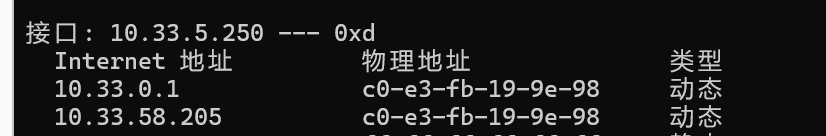
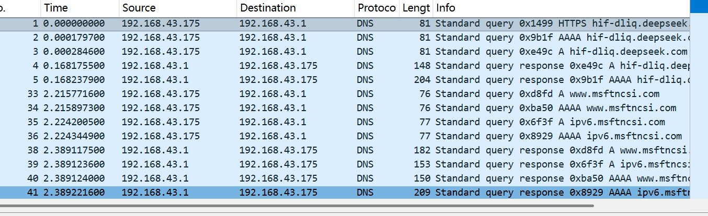
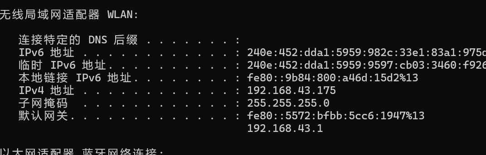
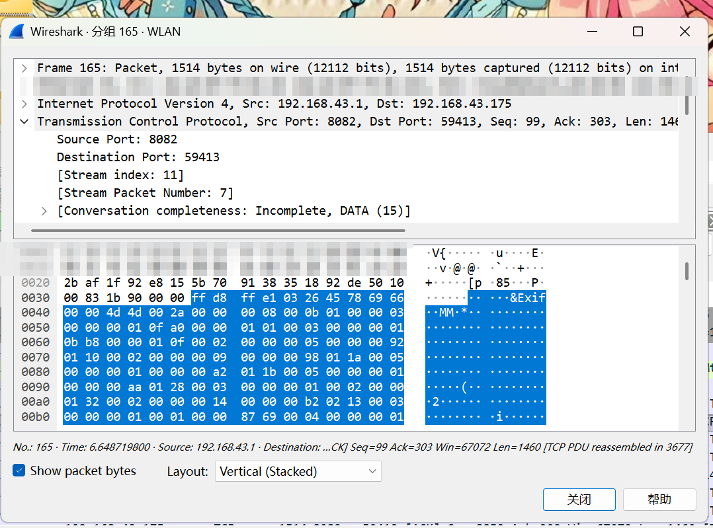
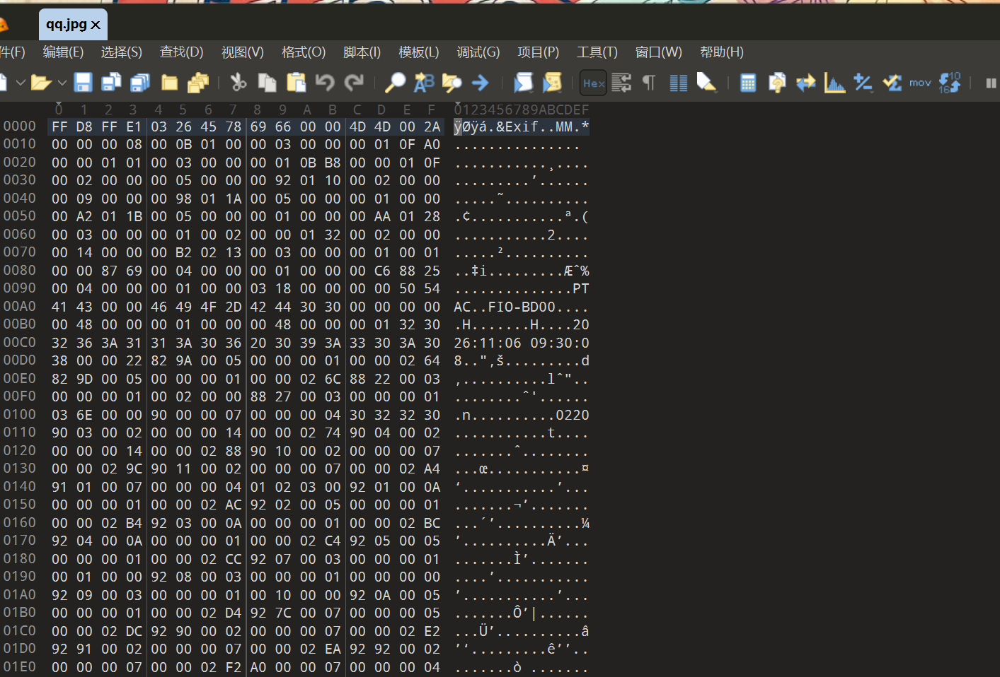
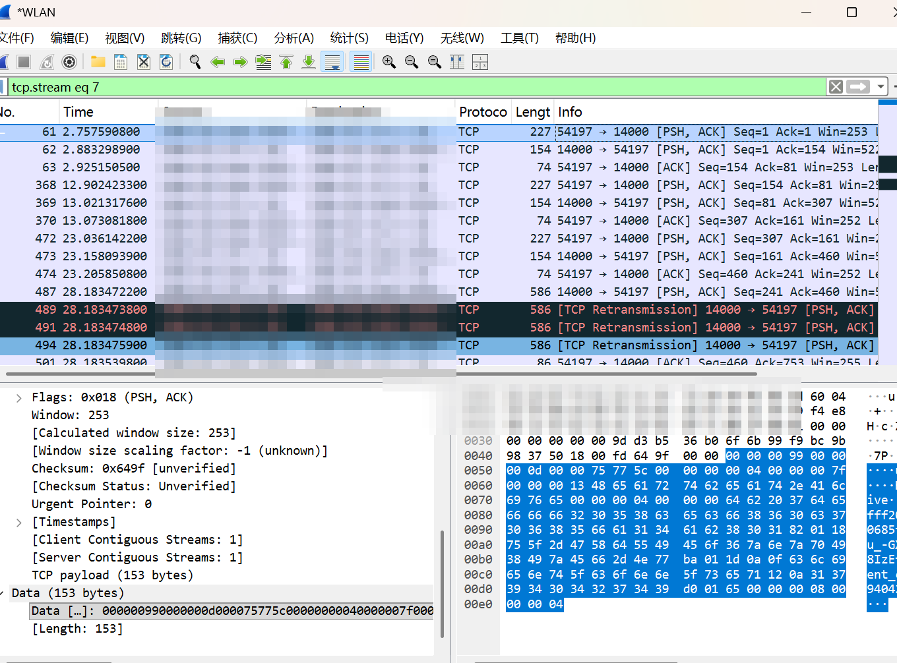

> 环境：Windows 11 / Wireshark 4.6.9 / 新版 QQ（QQNT）/ 安卓手机 / 手机热点

## 1. 我踩的坑

### 坑 1：把「同一个校园网」当成了「同一个局域网」

在询问 AI 的时候，它说只要可以 ping 通手机就是连接在同一个局域网，我以为这样就可以了，但是后面发现用 Wireshark 抓包的时候使用 `ip.src == 手机IP` 根本查不到东西，后面重看课堂回放才明白要连接同一个热点，老师说的是「同一个二级交换机」。

我在电脑上 `arp -a` 一看，手机 IP `10.33.xx.xx` 绑的 MAC 居然是**网关的 MAC**——网关替它回答了 ARP。



也就是说，我和手机看起来在同一个网段，其实**不在同一个二层广播域**，互访要绕网关。所以用 MAC 地址过滤也没用，网关把手机的 MAC 藏起来了。

`ping` 能通，我就觉得「网络没问题了」。但 QQ 局域网直传的第一步是「发现对方」，靠的是 **UDP 广播**。广播不跨 VLAN，手机根本发现不了我电脑，自然就不会往我的 IP 发包。所以我过滤 `ip.addr == 手机IP` 永远是空的——不是过滤器写错，是包根本没产生。

### 坑 2：开了热点还是抓不到

我心想，那开手机热点，总该是同一个二层了吧。结果抓到了一堆 DNS 的记录。



后来才明白：**电脑上的 QQ 没登录**。手机发「我的电脑」，电脑 QQ 不在线，QQ 就走**离线传输**——文件先传到腾讯服务器，等电脑上线再下载。这条路径是服务器中转，我抓到的只是到腾讯服务器的流量，当然没有手机 IP，也没有图片。

老师那句「**不要离线传输**」，说的就是这个。我当时没听懂，白忙半天。

## 2. 到底要满足什么条件

抓「手机传图给电脑」需要同时满足：

1. **同一个二层广播域**（同一个交换机 / VLAN，或者手机热点）；
2. **两端 QQ 都在线**（不能是离线传输）；
3. **数据是直连的**（P2P，不经过服务器中转）。

三个条件缺一不可。只满足「同子网、ping 通」是不够的。

## 3. 复现步骤

最后我是用**手机热点**成功的：电脑连上手机热点，拿到 `192.168.43.175`，网关是 `192.168.43.1`。



1. 手机和电脑登录同一个 QQ；
2. 手机 QQ →「我的电脑」→ 选一张图片 → 发送；
3. 电脑 QQ 接收；
4. Wireshark 选中 **WLAN** 网卡，开始抓包；
5. 过滤器 `ip.addr == 手机IP`，找到传输图片的那条 TCP 流；
6. 右键 → **Follow → TCP Stream**，看原始数据。

## 4. 图片怎么从包里「抠」出来

Follow TCP Stream 之后切到 **Raw**，另存为二进制文件，用 010 Editor 打开，找图片文件头：

- JPEG：`FF D8 FF`
- PNG：`89 50 4E 47`



从文件头开始选中到数据末尾，另存为 `.jpg`，图片就能打开了。QQ 的协议头在图片前面，删掉就行。



能打开图片，本身就说明：**这段文件传输是明文，没有加密。**

## 5. 回答老师的问题

### 5.1 UDP 还是 TCP？

我抓到的新版 QQ 流量基本都是 **TCP**：主连接、文件传输、心跳都是 TCP（端口 8080 / 14000 / 443 到腾讯服务器）。老师那台老版 QQ 抓到的是 UDP，应该是版本 / 传输模式的差异。

### 5.2 加密还是明文？

要分业务看：

| 流量类型 | 是否加密 | 证据 |
|---|---|---|
| 心跳报文 | **明文** | 载荷里直接有 `Heartbeat.Alive` |
| 文件传输（图片） | **明文** | JPEG 文件头直接可见，能还原成图片 |
| 聊天文字消息 | **加密** | 发 `hello world!` 抓包搜不到，正文是密文 |

为了验证文字消息，我又给电脑发了一条 `hello world!`，然后在抓包文件里搜这串字符——**搜不到**。而图片的 `FF D8 FF` 一眼就能看到。所以 QQ 不是「全加密」，也不是「全明文」，**取决于具体是哪种流量**。

## 6. 心跳报文

### 6.1 什么是心跳

QQ 登录后会跟服务器保持一条长连接，隔一段时间发一个很小的包，告诉服务器「我还在」，顺便维持 NAT 映射。这个包就是**心跳**。

### 6.2 怎么抓

Wireshark 显示过滤器输入：

```
tcp contains "Heartbeat.Alive"
```

新版 QQ 的心跳是明文的，载荷里直接有这串字符，一秒定位。抓的时候让 QQ **保持登录、空闲 1～2 分钟**，别发消息。

> 命令行（tshark）注意：PowerShell 会把双引号吃掉，可以改成十六进制写法：
> ```
> tshark -r qq_hb.pcap -Y "tcp contains 48:65:61:72:74:62:65:61:74"
> ```



### 6.3 我抓到的特征

| 项目 | 实测值 |
|---|---|
| 传输层 | TCP |
| 客户端 → 服务器 | 207 字节帧（153 字节载荷） |
| 服务器 → 客户端 | 134 字节帧（80 字节载荷） |
| 周期 | 约 15 秒 |
| 明文特征 | 载荷里有 `Heartbeat.Alive` |

判断技巧：同一个连接、包大小固定、间隔固定 → 典型心跳；把 QQ 退出登录，心跳消失，重新登录又出现。

## 7. 总结

1. 抓包不是「点开始就行」，先搞清楚数据到底走哪条路；
2. 「同一个局域网」要落到**二层广播域**，同子网、ping 通都不算数；
3. 老师的话要听：「不要离线传输」是题眼；
4. 新版 QQ 以 TCP 为主，心跳和文件传输是明文，聊天消息加密；
5. 发博客前记得打码：QQ 号、IP、设备 token 都别直接放出去。

## 附：环境与工具

- Windows 11
- Wireshark 4.6.9
- 新版 QQ（QQNT）
- 安卓手机 + 手机热点（`192.168.43.x`）
- 抓包网卡：WLAN