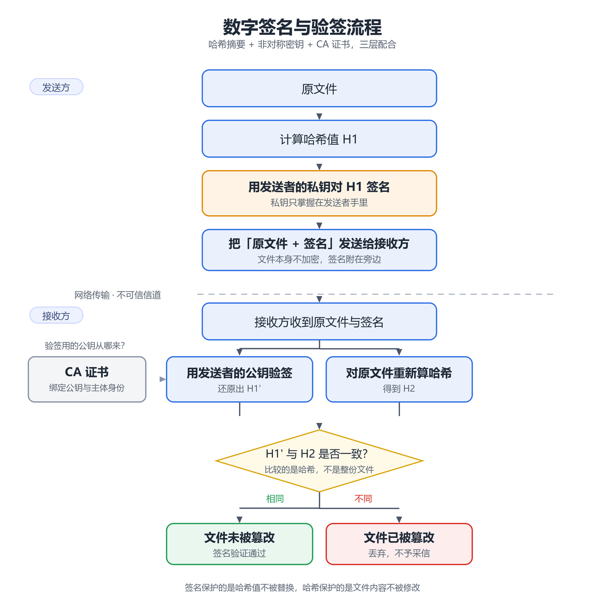

> 关键词：数字签名 / 哈希 / 非对称加密 / CA 证书 / Burp Suite / 中间人

## 1. 数字签名

数字签名用来确认消息在传递过程中有没有被篡改，同时也确认消息确实来自持有对应私钥的一方。签名用的是非对称加密的一对公钥和私钥。

一份要签名的文件，发送者先算出它的哈希值，再用私钥对哈希值做签名运算（RSA 场景下可以粗略理解为“用私钥加密哈希”，更一般地说是用私钥生成签名），然后把原文件和签名一起发给接收者。

接收者收到后，用发送者的公钥验证签名、还原出哈希值，再对原文件重新算一遍哈希，两个哈希一对比，就知道文件有没有被动过。

这里就留下一个问题：接收者怎么确定自己手里的公钥真的属于发送者？这正是 CA 证书要解决的问题——证书把公钥和某个主体绑定在一起，再由 CA 用自己的私钥签名背书。

至于为什么不直接对文件本身签名，而要绕一层哈希，原因有两点：

- 文件一大，非对称运算就很慢；
- 非对称加密的运算开销远大于哈希。

哈希能把任意长度的文件压成定长摘要，只对摘要做私钥运算，在效率和工程实现上都更合理。文件哪怕只改一个字节，重新算出的哈希也会完全不同，和解出来的哈希对不上，篡改就被发现了。

> 签名保护的是“哈希值”不被替换，哈希保护的是“文件内容”不被修改，两层是配合关系。

*图 1：签名与验签的完整流程，菱形判定之后的“相同 / 不同”两条分支就是篡改检测的结果*

## 2. CA 证书

CA 证书的作用，就是证明某个公钥属于某个主体，由 CA 机构签发。CA 会用自己的私钥给证书签名。

这样上一节留下的问题就有答案了：接收者只要信任签发这张证书的 CA，也就能确认手里的公钥确实属于发送者。

## 3. Burp Suite 是怎么伪装的

Burp Suite 如果想抓 HTTPS 网站，就要让客户端信任 Burp 的 CA 证书，否则看到的只是一团乱码。下面说明装上证书之后，Burp 是怎么伪装的。

正常情况下，客户端向服务端发送请求，服务端会把证书发给客户端。开启 Burp Suite 后，Burp 会把这个证书截下来，换成自己签发的证书发给客户端，冒充服务端和客户端对话。Burp 用自己的私钥解开、看到明文后，再以客户端的身份和真正的服务端建立连接，把请求转发过去，从而充当一个中间人。

不过这个操作的前提是客户端安装了 Burp 的 CA 证书，只有这样客户端才会信任 Burp 签发的证书。
